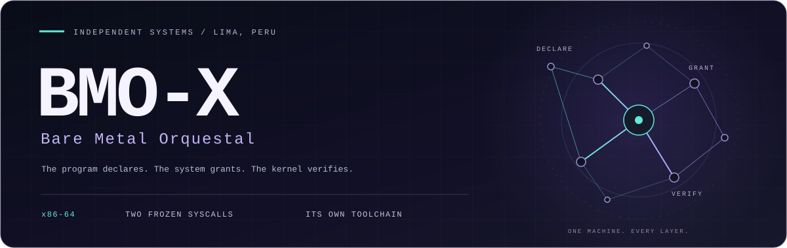
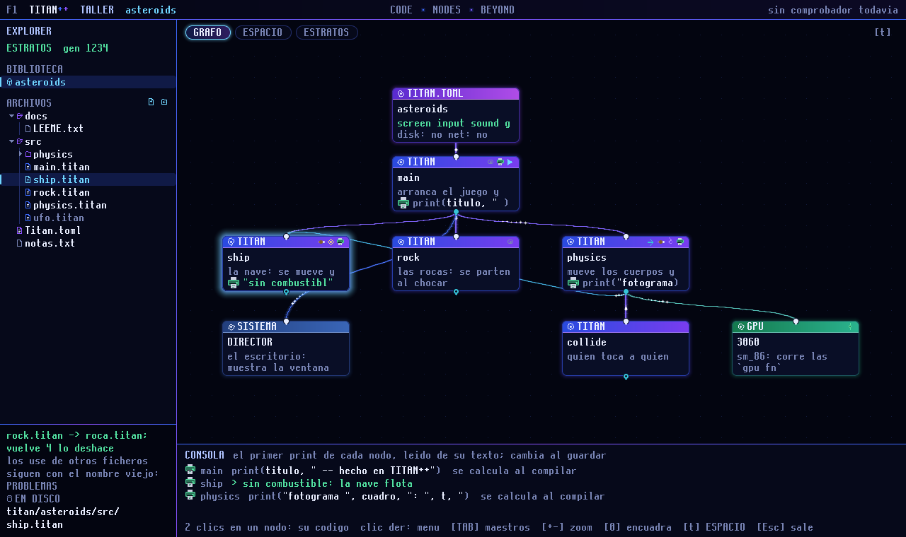

<p align="center">
  
</p>

<h1 align="center">BMO-X</h1>
<p align="center"><strong>An independent x86-64 system, from the firmware to its own languages.</strong></p>
<p align="center">Built in Lima, Peru, by Eddi Salazar. Real hardware. Measured results. Explicit limits.</p>

<p align="center">
  <a href="#what-runs">What runs</a> &nbsp;&middot;&nbsp;
  <a href="#mundo">MUNDO</a> &nbsp;&middot;&nbsp;
  <a href="#titan">TITAN++</a> &nbsp;&middot;&nbsp;
  <a href="#verrano">VERRANO &amp; RTX 3060</a> &nbsp;&middot;&nbsp;
  <a href="#try-it-yourself">Build</a> &nbsp;&middot;&nbsp;
  <a href="#going-deeper">Explore</a>
</p>

<p align="center">
  <code>Ryzen 5 5600X</code> &nbsp;
  <code>RTX 3060 12 GB</code> &nbsp;
  <a href="#case-file-the-booter-that-said-no-0x15"><code>G0 OPEN</code></a> &nbsp;
  <a href="LICENSE"><code>Apache-2.0</code></a>
</p>

BMO-X calls its design **Bare Metal Orquestal**: programs declare what they
need, the system grants capabilities, and the kernel checks their use.
Its UEFI boot chain, kernel, desktop, filesystem, native compiler paths and
executable format are developed together in this repository.

**The machine is the workshop.** TITAN++ builds native applications; VERRANO
carries their drawing; ESTRATOS preserves their versions; CABINA records what
happened. MUNDO, a native block game, now exercises that whole path on the Ryzen.

> **El programa DECLARA. El sistema CONCEDE. El kernel solo COMPRUEBA.**
>
> Authority is functional, never inherited. A program's handles determine
> what it can do. The mechanisms and their costs are in
> [EL ORQUESTAL](docs/identidad/EL_ORQUESTAL.md) and [ARQUITECTURA](ARQUITECTURA.md).

<details>
<summary><strong>En castellano</strong></summary>

BMO-X se construye como una maquina propia: arranque UEFI, kernel, escritorio,
lenguajes, herramientas y formato ejecutable. Su identidad es **Bare Metal
Orquestal**. Los programas declaran recursos y reciben capacidades explicitas.

El foco actual es MUNDO, un juego nativo de bloques en TITAN++ y VERRANO.
Ya se juega en el Ryzen y hubo una corrida con dibujo por la RTX 3060.
El arranque de su firmware sigue siendo intermitente: el `0x15` NO esta
resuelto. La ultima sesion funciono con respaldo CPU, con una muestra de
19,60 FPS y capturas PNG guardadas por BMO-X.

El kernel tambien crece como **lente**: bytes en orden, hexadecimal y bits,
fallos explicados en castellano y un informe que conserva las medidas.
La inspiracion Fungi y sus mecanismos estan en
[EL REINO FUNGI](docs/identidad/EL_REINO_FUNGI.md).
La portada sigue en ingles; la documentacion tecnica y la voz del sistema
estan en castellano.

</details>

---

<a id="what-runs"></a>
## On the real machine

<p align="center">
  
  <br><sub>BMO-X's own desktop and telemetry. Historical capture; GPU availability varies by boot.</sub>
</p>

**Status reviewed: 16 October 2026.** Hardware evidence is from one machine:
an **AMD Ryzen 5 5600X with an NVIDIA RTX 3060 12 GB**. It does not establish
support for every x86-64 PC.

| State | What it means here |
|:---:|---|
| **METAL** | Observed on the real Ryzen, or explicitly confirmed by its owner; the evidence states which. |
| **HOST** | Implemented and checked on the development host; the corresponding hardware test is still pending. |
| **OPEN** | An unresolved limit, or work that is still planned. |

| Part of the orchestra | What has been observed | Evidence / limit |
|---|---|---|
| **Boot and isolation** | UEFI to Ring 0 to Ring 3; userspace faults reported by the kernel; keyboard and mouse through the USB stack. | [Hardware evidence](docs/evidencia/). |
| **Native applications** | Programs from the house compilers run as `.bex`; TITAN++ now powers MUNDO. | [MUNDO results](docs/metal/METAL_2026-10-16.md). |
| **Desktop and tools** | Windows, TINTA, ECCE, image viewing, CABINA, sound controls and reports. | [Captured evidence](docs/evidencia/), [desktop](Ultra_userspace/README.md). |
| **DOOM** | Played in a window on the CPU; recorded runs include 58 FPS at x5 and about 70 FPS at x3. | Historical runs at different sizes, not a GPU benchmark: [photo](docs/evidencia/22-doom-y-la-3060.jpg). |
| **ESTRATOS** | Files written and versioned on the real volume. | Branch/merge has host tests; its hardware validation remains separate. [Plan](docs/plan/PLAN_LAS_RAMAS.md). |
| **RTX 3060** | Successful boots, compute, hardware rasterization, image completion and MUNDO frames. | Boot reliability **G0 remains open**; see [VERRANO](#verrano). |
| **Self-observation** | PNG screenshots, structured reports and a paged hexadecimal/bit view. | Full-screen PNG confirmed; newer diagnostics still need hardware observation. |

### Captured by the machine itself

<p align="center">
  
  <br><sub>A documented GPU run: image completion with a CPU judge. A successful run is evidence of that workload, not of reliable startup on every boot.</sub>
</p>

[Watch the recorded boot](docs/evidencia/15.mp4) &middot;
[Browse the evidence and its limits](docs/evidencia/README.md)

---

<a id="mundo"></a>
## MUNDO / a native world, a demanding test

**MUNDO is a block game written in TITAN++, drawing through VERRANO.**
The owner has played it on the Ryzen: moving through the scene, removing
and placing blocks, and saving the world. It gives the language, input,
windowing, persistence and graphics paths a shared, visible workload.

| Implemented | Why it matters |
|---|---|
| Native camera, central crosshair and a 3D picking ray | Looking and editing use the same camera orientation. |
| Relative mouse movement and a hidden captured pointer | The desktop's screen edges no longer bound the game's look direction. |
| Focus-aware capture | First Esc releases the pointer; clicking inside recaptures; losing focus revokes capture. Another Esc saves and exits. |
| Reusable TITAN++ modules | Camera components and the [pointer module](Ultra_userspace/apps/mundo/src/pointer.titan) can serve other applications. |
| Saved block changes | The world has persistence; host tests also exercise corrupt files and write failures. |
| GPU / CPU counters, rejection reasons and sampled FPS | A visible window no longer has to be mistaken for proof of GPU rendering. |

**Two sessions, two different results.** Both belong in the record:

| 16 October session | GPU frames | CPU fallback frames | What it establishes |
|---|---:|---:|---|
| 19:37-19:39 | **325**, all through borrowed buffers | **0** | The RTX rendered MUNDO in its window. The judge still found **4 different pixels out of 230,400**. |
| 20:36 | **0** | **1,141** | MUNDO remained usable when GPU firmware startup failed. The FPS sample was **19.60**, over 20 intervals / 1,020 ms. |

That FPS sample is from **CPU fallback**, not the RTX, and is not a whole-session
average. The GPU/CPU equality goal **Q0a3 is still open**.

MUNDO is its own native game. The local Minecraft study informed research into
resources and structure; it does not make this a port of Minecraft, and original
Minecraft code or assets are not bundled here. Larger worlds, physics, jump,
collision, textures and targeted-block highlighting remain on the plan.

[Controls](Ultra_userspace/apps/mundo/CONTROL.md) &middot;
[Source](Ultra_userspace/apps/mundo/src/main.titan) &middot;
[Plan](docs/plan/PLAN_MUNDO.md) &middot;
[Measured sessions](docs/metal/METAL_2026-10-16.md)

---

<a id="titan"></a>
<a id="estratos-titan-and-the-taller"></a>
## TITAN++ / small vocabulary, growing capability

TITAN++ is a house language for native programs and for the **TALLER**, where
modules become nodes and imports become cables. Its object model is
**composition, traits and explicit ownership**.

The latest language work lets an owned function borrow a mutable component,
including nested fields and trait components. It also constructs new records
directly in their destination where supported, reducing temporary stack copies.
Both changes help real applications such as MUNDO without adding new keywords.

| Capability | Current boundary |
|---|---|
| Named records, nested components, modules and public declarations | Composition is implemented; class inheritance is not. |
| Shared behavior through traits | Native trait dispatch currently has a type tag and comparison/jump cost. |
| Mutable component loans | Owner-level exclusivity remains conservative; partial `take` and disjoint sibling loans are not promised. |
| Exact decimals and checked indexing | Optimizations must prove a check unnecessary before removing it. |
| Native x86-64 emission | The native compiler paths use their own emitters rather than LLVM or GCC. The Rust build of BMO-X still uses the Rust toolchain. |

See a complete, checked example: [breakable Stone and Wood](toolchain/lang/titan/ejemplos/nivel10/bloques.titan).
The implementation and limits are documented in [Objects](toolchain/lang/titan/OBJETOS.md),
[Grammar](toolchain/lang/titan/GRAMATICA.md) and [TITAN master](docs/maestro/TITAN_MAESTRO.md).

### M3a / fewer instructions, the same safety contract

For insertion-sort of 600 elements, the host instruction meter records:

| Metric | Before | After |
|---|---:|---:|
| Executed instructions | 1,186,491 | **824,134** |
| Memory accesses | 271,528 | **271,528** |
| Code bytes | 3,625 | **3,530** |

**30.54% fewer instructions in this workload.** The emitter reuses proven
index bounds; it retains the check when the proof is missing. This is an
instruction count, not elapsed time or Ryzen cycles.
[Method, commands and limits](toolchain/tools/metro/M3A_Y_LENTE.md).

### TALLER and ESTRATOS / code you can see, history you can keep

<p align="center">
  
  <br><sub>Rendered by TALLER's painter on the host. This illustration is not a hardware screenshot.</sub>
</p>

**TALLER** exposes the package as a graph. The basic graph has been seen on the
Ryzen; later interactions carry their own validation status.
**ESTRATOS** is the versioned filesystem: writes preserve history, and the
branch/merge engine compares whole nodes by BLAKE3. Conflicts require a person's
choice. The host merge tests and a real-volume merge are different milestones.

[TALLER plan](docs/plan/PLAN_TALLER.md) &middot;
[Branches and merge](docs/plan/PLAN_LAS_RAMAS.md) &middot;
[Data model](docs/plan/PLAN_LOS_DATOS.md)

---

<a id="verrano"></a>
<a id="the-rtx-3060-driven-from-scratch"></a>
## VERRANO / drawing with a witness

VERRANO is BMO-X's drawing API. Native applications submit drawing data through
its own pipeline and **BSF** shader format, with a CPU reference path and an
RTX 3060 backend. MUNDO calls VERRANO directly. PROTON-X translates a different
client: Windows graphics workloads.

The GPU driver is developed here; **NVIDIA's signed firmware is still required**
and runs on the card. Driving the card from BMO-X does not mean replacing that
firmware or supporting every GPU.

**Successful runs have demonstrated real GPU work.** Documented workloads
include bit-checked compute, hardware triangles, full-screen output and image
completion. On 16 October, a VERRANO reference case matched the CPU and D3D12
reference; MUNDO later submitted 325 GPU frames through borrowed buffers.
Each result belongs to its own scene and session.

The 640x360 depth-buffer rejection in MUNDO was traced to local destination
validation. The correction admits the smaller destination and copies its actual
rectangle from the fixed surfaces. The subsequent GPU session confirmed that
path; the four-pixel equality difference remains under investigation.

`gpu laminas` and `save` now distinguish GPU frames, CPU fallback, sampled FPS,
and the original rejection stage and reason. The counters establish who drew;
the pixel judge establishes whether the images agree.

[Drawing diagnostics](platform/shared/verrano/DIAGNOSTICO.md) &middot;
[VERRANO plan](docs/plan/PLAN_VERRANO.md) &middot;
[Card anatomy](platform/drivers/gpu/ga10x/ANATOMIA.md)

<a id="case-file-the-booter-that-said-no-0x15"></a>
### Case 0x15 / the unresolved gate

**G0 is open: the GSP firmware does not start reliably.** Earlier removal of
BMO-X's pre-boot DMA self-tests produced successful boots, but later `0x15`
failures occurred without those tests and with a recorded cold arrival.
That earlier result did not close the whole case.

The latest failed session records intact firmware memory, no new IOMMU events,
and a signed booter that stopped with `MAILBOX0 = 0x15`. The recovery attempt
also failed to release the protected WPR2 region. Those facts do not establish
an electrical cause or decode NVIDIA's error code.

The new **host-validated** diagnostic captures the GSP mailboxes and controls
immediately before the booter starts, alongside the expected LIBOS pointer.
The report also stops recommending an already-blocked retry. These are
investigation improvements; **they have not yet fixed or been observed fixing
startup on the RTX**.

[Current investigation](platform/drivers/gpu/ga10x/DESPERTAR_FIABLE.md) &middot;
[Case file](platform/drivers/gpu/ga10x/EL_0x15.md) &middot;
[Boot-by-boot data](platform/drivers/gpu/ga10x/EL_0x15_ARRANQUES.csv)

---

## The kernel as a lens

The system records what failed and keeps the underlying bytes visible.
`dentro bits` reads a file in bounded pages, preserving byte order and showing
hexadecimal alongside eight bits per byte. File offsets remain distinct from
instruction addresses and from the order in which instructions execute.

```text
dentro bits 0x0 apps/ecce/nucleo.bex
dentro bits 0x40 apps/ecce/nucleo.bex
```

The Ryzen session showed 128 consecutive bytes with matching hex and bits.
It also exposed a truncated offset label, corrected on the host. The corrected
label, EOF cases and the new raw crash view retain their separate hardware tests.
[Evidence and remaining checks](docs/metal/LENTE_CRUDA_2026-10-16.md).

Full-screen **1080p PNG capture now works on the machine**: two files were
saved after the temporary-memory fix. A single temporary allocation avoids
exhausting the process's block slots. Window and region capture still need
their own confirmation.

---

## PROTON-X / an ambitious client

<p align="center">
  
  <br><sub>13 October 2026. Cyberpunk's intro, captured by BMO-X. This is not a claim of playability.</sub>
</p>

PROTON-X loads Windows PE programs and supplies its own compatibility functions
and graphics translation. A documented run of **Cyberpunk 2077** displayed its
intro on BMO-X. That run used CPU rendering, at roughly **16 seconds per frame**;
its game draws were not successfully rendered by the RTX. **It is not playable.**

GPU startup, graphics-channel recovery and unsupported shader operations remain
distinct problems. Native MUNDO is the current graphics test vehicle.
The three retired sample executables (`htriang`, `hframes`, `nbody`) are no
longer shipped; their shader tests remain, and HelloBundles retains an analytic
triangle judge.

[Cyberpunk run](docs/metal/METAL_2026-10-13.md) &middot;
[PROTON-X staircase](docs/plan/PLAN_LA_ESCALERA_PROTON_X.md)

---

## One repository, several instruments

| Instrument | Responsibility |
|---|---|
| **Kernel and capabilities** | Resource boundaries, admission, isolation, `INVOKE` and `WAIT`. Two frozen syscall entries; operations live within them. |
| **DIRECTOR** | Desktop, focus, windows, cooperative input capture and diagnostic reports. |
| **Six native language paths** | C, C++, COBOL, Ada, INTI and TITAN++, with different maturity levels. |
| **BEF2 / `.bex`** | The admitted executable container, its regions, attachments and integrity checks. ELF can still be an intermediate build artifact. |
| **ESTRATOS and TALLER** | Persistent versions and visible program structure. |
| **VERRANO, BSF and PROMETEO** | Drawing, shader packaging and the house intermediate program. |
| **AYNI** | Experimental CPU/GPU work distribution; its plans and measurements remain workload-specific. |
| **CABINA, the meter and the guardians** | Reports, reproducible measurements and build-time checks. |

The design is deliberately x86-64. Other architectures are outside this
repository's target. The [Fungi inspiration](docs/identidad/EL_REINO_FUNGI.md)
connects its language of loans, growth and diagnosis to actual mechanisms.
The contracts and their costs are written in [the FUERO](FUERO/EL_FUERO.md).

---

<a id="try-it-yourself"></a>
## Build, then choose where to deploy

**The build currently requires Windows and PowerShell.** Rust and the build's
LLVM utilities are prerequisites; the scripts locate the toolchain they need.
Read [CONTRIBUTING](CONTRIBUTING.md) before preparing another machine.

Build and run the verification path, without deploying to a boot volume:

```powershell
.\bmo.ps1
```

Verification now records phase and package timings and preserves the complete test bank.
See [verification and build timing](toolchain/tools/verificar/README.md).

To run compilation and verification in separate windows:

```powershell
.\bmo.ps1 -Paralelo
```

Deployment is a separate action. The following letters are **examples**;
replace both with the intended FAT32 boot/data volumes:

```powershell
.\desplegar.ps1 -Arranque E -Datos E
```

Deployment writes to the selected volumes. Verify their identity first.
Secure Boot must be disabled for the documented boot procedure. Select BMO-X
from the motherboard's UEFI boot picker. Hardware beyond the documented Ryzen
has not been established by this README.

After a normal MUNDO session, these commands retain the relevant evidence:

```text
gpu laminas
save
```

The new pre-booter diagnostic requires **both a rebuilt kernel and DIRECTOR**.
One normal session, successful or failed, supplies a useful report; repeated
reboots are not the default investigation procedure.
The documented rescue shortcut, **Ctrl+Alt+Esc**, returns keyboard and screen
control to the kernel.

### Verify the claim you are changing

```powershell
cargo test --workspace --exclude bmo-kernel
cargo test -p bmo-titan-x86-64 --test mundo
```

The build checks source encoding, contracts, module boundaries, stack budgets
and other project invariants. Test counts change; the output of the current
run is the record. The last focused GPU / PROTON-X validation passed **670
host tests**, with the kernel checked and DIRECTOR compiled in release.
The Linux-only EXE execution bank was not run on this Windows host.
None of those checks alone proves hardware startup or gameplay.

---

## What is next

The current order keeps the blocking issue visible:

1. **G0: reliable RTX startup.** Compare the new pre-booter snapshot with
   the saved post-failure state. No guessed voltages or reset sequences.
2. **Q0a3: image equality.** Isolate the four differing pixels when the GPU
   is available; preserve the successful borrowed-buffer path.
3. **MUNDO: the next playable layer.** Targeted-block highlighting, held
   controls, collision, gravity and jump; then larger worlds and textures.
4. **TITAN++: mature the existing model.** Measure trait specialization and
   extend ownership only with explicit rules and tests.

[Current focus](docs/plan/EL_FOCO.md) &middot;
[MUNDO milestones](docs/plan/PLAN_MUNDO.md) &middot;
[RTX plan](docs/plan/PLAN_LA_3060.md)

---

<a id="going-deeper"></a>
## Follow the threads

| Start with | For |
|---|---|
| [FUERO](FUERO/EL_FUERO.md) | Building on the system: what is granted and what is required. |
| [Architecture](ARQUITECTURA.md) | The mechanisms behind the design. |
| [Kernel law](FUERO/META-KERNEL_HARD.md) | Constraints, their reasons and their enforcement. |
| [16 October hardware record](docs/metal/METAL_2026-10-16.md) | MUNDO, GPU sessions, captures and the limits of the evidence. |
| [TITAN++](docs/maestro/TITAN_MAESTRO.md) / [Object model](toolchain/lang/titan/OBJETOS.md) | Language design, implemented behavior and open work. |
| [Toolchain](toolchain/README.md) / [Platform](platform/README.md) | Compilers, shared components, ABI and drivers. |
| [Advances](AVANCES.md) / [Log](BITACORA.md) | Development history and the problems behind changes. |
| [Documentation index](docs/README.md) / [Evidence](docs/evidencia/README.md) | The deeper plans, recordings and measurements. |

### Contribute and report

The most useful contribution is a precise boot report from another machine:
CPU, board, the last visible stage and its evidence.
**Ring 0 is closed to external contributions** under the current project policy;
application, Ring 3 and Antena work have their own scope.
See [CONTRIBUTING](CONTRIBUTING.md) and [CODEOWNERS](.github/CODEOWNERS).

### License and authorship

[Apache License 2.0](LICENSE), with notices and third-party material described in
[NOTICE](NOTICE). NVIDIA firmware and third-party games retain their own terms.

<p align="center">
  
  <br><strong>Eddi Salazar &middot; Lima, Peru</strong>
  <br>Building BMO-X since 17 April 2026.
  <br><a href="https://github.com/AndreeSalazar">GitHub</a> &middot; eddi.salazar.dev@gmail.com
</p>
