# Evidence -- BMO-X on real hardware

Photographs and a recording of BMO-X running on the test bench. **Not screen
captures** (section 12 is the exception, and says why): a camera pointed at a physical monitor, because the claim is *"this
is not an emulator"* and a screen capture cannot prove that.

**Test bench:** MSI A320M PRO MAX - AMD Ryzen 5 5600X (Zen 3) - Kingston
SA400S37480G SATA - 1920x1080 UEFI GOP.

---

## 1. It is a real boot entry on real firmware


The motherboard's own boot picker lists `BMO-X (SATA3: KINGSTON SA400S37480G)`
next to `Windows Boot Manager` on the same machine. No virtual machine, no
hypervisor -- the firmware is choosing between two operating systems on physical
disks.

## 2. The kernel enumerates real hardware


- `[ring0] mem 14 GiB physmap listos` -- physical memory map built
- `[ring0] scheduler preemptivo + capabilities armados` -- scheduler and
  Capability Engine up
- `[usb] xHC pci 0x3:0x0.0x0 mmio=0xFC6A0000` -- a real xHCI controller at a real
  PCI address with its real MMIO window; then a second at `0x2B`
- `[uhid] ... class=0x3 sub=0x1 proto=0x2 -> lo tomo` -- HID descriptors parsed and
  the interface claimed
- `[usb] teclado USB listo` / `[usb] mouse USB listo`

Those PCI addresses and descriptor values are what the hardware answered.

## 3. A desktop, in Ring 3, loaded from disk


`gui.bex> escritorio pintado`. The compositor is **not in the kernel** -- it is a
`.bex` loaded from the data volume, painting directly into a framebuffer it
holds as a capability. Changing the desktop does not recompile Ring 0.


The launcher: `ruta de un .bex y Enter. info / cpu / mem / ls / lee / reboot.`
This is what makes it an interactive system rather than a boot log.

## 4. The system reports on itself


```
uarch      Zen 3 (Vermeer)  familia 19h/21h
nucleos    6 fisicos / 12 hilos
tsc        3.70 GHz (medido)
total      14.8 GiB   3886100 marcos de 4 KiB
usada      5.4 MiB    [--------------------] 0%
kernel     2.1 MiB    en 0x400000
ranuras    4 en uso de 64
programas  17 lanzados
disco      listo
datos      montado para escritura
```

**5.4 MiB of 14.8 GiB -- 0%.** The TSC frequency is *measured*, not read from a
table. The kernel is 2.1 MiB at a known address.

---

## The three languages, on silicon

This is the part that matters. Each program below was compiled by BMO-X's own
toolchain -- no GCC, no LLVM -- and executed on the Ryzen.

### C -- arithmetic, strings, hex


```
holac.bex> hola desde C en el Ryzen
holac.bex> suma 1..10 = 55
holac.bex> 42-100=-58   100/7=14   100%7=2
holac.bex> cadena=viva hex=beef
           origen  FAT32     leido  12.00 KiB
           firma   FAT32 no puede llevar firma (sin atributos)
holac.bex> C termino ok
```

Signed arithmetic, integer division and modulo (`idiv` with correct sign
extension), `%s` and `%x`. Loaded from a real FAT32 file.

And note the `firma` line: the loader **says why** it cannot verify the
signature instead of skipping silently. FAT32 has no named attributes, so it
cannot carry `:firma` next to the binary. That single line is the reason
ESTRATOS exists.

### COBOL -- interactive, exact decimals


```
run apps/calc.bex
calculadora COBOL - importes con dos decimales
primer importe:  5
segundo importe: 90
suma:   95.00
resta: -85.00
```

`ACCEPT` reading from the terminal that launched it, in a process that does not
hold the keyboard capability and does not need it.

### COBOL -- a banking batch that writes a file and reads it back


```
run apps/batch.bex
BATCH DE CIERRE - BANCO BMO
total del dia:
 $1,135.00
cierre escrito en apps/cierre.txt
lee apps/cierre.txt
 1135.00
```

**This is the whole thesis in one screen.** It reads transactions from disk,
totals them in integer cents, formats the total through an edited `PICTURE`
(`$1,135.00` -- currency sign, thousands separator, two decimals, all emitted as
instructions), **writes the close to a file**, and then the file is read back to
show `1135.00` really landed on disk.

Read -> compute -> write a report. That is what banking software is.

### Ada -- the same exact decimal


```
run apps/cierre.bex
CIERRE EN ADA - BANCO BMO
total de tres cuotas:
59.97
tras la devolucion:
39.98
```

**`19.99 x 3 = 59.97`, and `59.97 - 19.99 = 39.98`.** Exact, in integer scale,
no floating point anywhere. The same number COBOL produces, for the same reason:
Ada's Annex F copied COBOL's `PICTURE` rules in 1985, so the decimal work was
already paid for.

Three languages, one binary format, one machine.

---

## Fault recovery, recorded as it happened


```
CABINA  eventos=50  perdidos=0
48 INFO  ring3: primer CONSOLE_WRITE: userspace habla
49 INFO  fb: pantalla cedida a Ring 3
50 INFO  input: raton cedido a Ring 3
51 INFO  consola: consola creada para Ring 3
52 WARN  fb: el propietario de la pantalla MURIO: se vuelve al panel del kernel
53 INFO  ring3: proceso termino por su cuenta (EXIT) =2
54 INFO  ring3: proceso termino por su cuenta (EXIT) =6
55 INFO  ring3: proceso termino por su cuenta (EXIT) =3
56 INFO  ring3: proceso termino por su cuenta (EXIT) =4
57 INFO  usb: puerto: ENCHUFADO, nada que adoptar
```

**Line 52 is the most valuable line in this folder.** A Ring 3 process that
owned the framebuffer died, and the kernel **took the screen back** instead of
leaving a dead display. That is capability revocation (`revoke_all` on death)
firing on real hardware, with CABINA recording it at the instant, at WARN level.

`perdidos=0` -- CABINA lost zero events. `ENCHUFADO, nada que adoptar` -- hot-plug
detected and answered *with a reason* rather than in silence.

A system that only ever reports good news is not reporting anything.

---

## 11. And one that shows a bug, on purpose


2026-09-04. DOOM at 1600x1000 with the status bar and the full view width --
and vertical bands where the **title screen from an earlier frame is still
showing through**. Those columns were never painted: a wall segment that enters
`R_AddLine` with `x1 > x2` is dropped in silence, and what stays on screen is
whatever was there before.

The cause was found in the compiler, not in DOOM: `(angle + ANG90) >> 19` was
not being truncated to 32 bits, so one carry escaped and an index into
`viewangletox[4096]` came out as **9215** -- 5.119 integers past the end of the
table. `9215 = 1023 + 8192`, and `8192 * 2^19` is exactly `2^32`.

It is here because the rule of this folder cuts both ways: a folder that only
ever shows good news is not showing anything.

---

## 12. And BMO-X photographing itself

> [!] **These two are screen captures, and the rule at the top still stands**:
> a capture cannot prove the machine is not an emulator -- the photographs above
> do that. What a capture proves is something a camera cannot: **that BMO-X can
> write down its own screen and hand it to another operating system**, pixel for
> pixel.

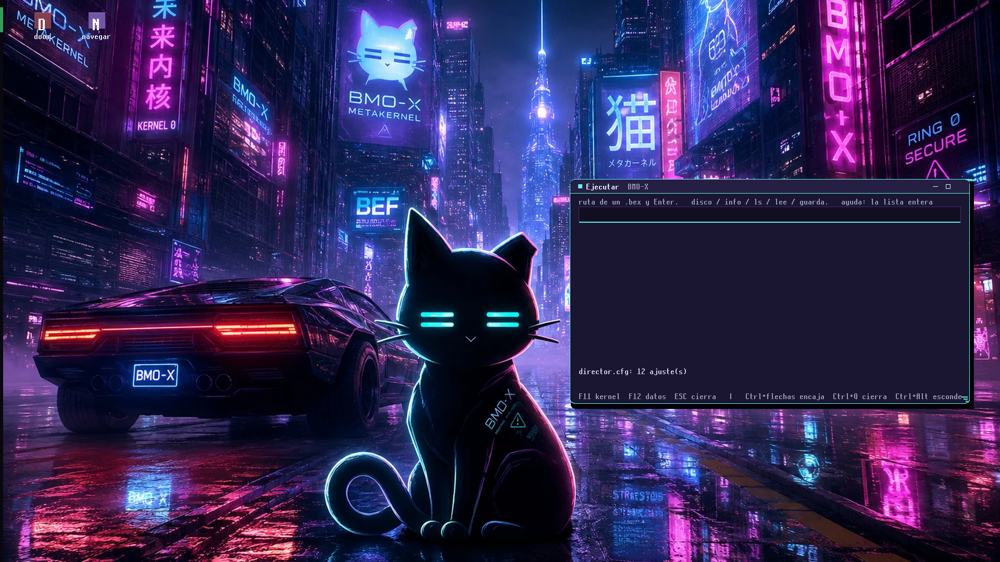

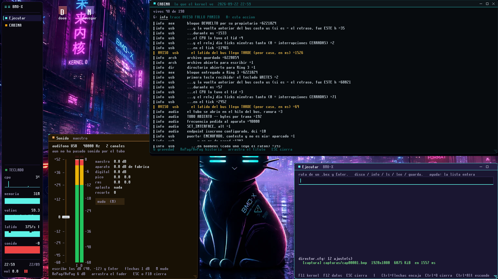

2026-09-22, 22:57-22:59, on the Ryzen. The whole path is BMO-X's own:

```text
   Impr Pant    the USB bridge gives the key its own scancode (it used to
                arrive as the numpad `*`), the kernel turns it into 0x95
   the pixels   read back from the compositor's canvas, where the apps are
                already composed; under the pointer, what the pointer hides
   the file     a 24-bit BMP, written through its own FAT32 driver to
                `capturas/cap0000N.bmp` -- 6.220.854 bytes, 1920x1080
   the proof    Windows opened them from the same disk, untouched
```

The PNGs here are those BMPs converted without loss: same pixels.

What the second one shows working at once: the panel on the left (the cat's
eyes, the windows, the keyboard light, five live graphs, the clock and the
volume), CABINA reading the kernel's log, the sound master window, the city
wallpaper, and the line in `Ejecutar` that reported the first capture:
`[captura] capturas/cap00001.bmp  1920x1080  6075 KiB  en 1557 ms`.

**And what it caught, because the rule cuts both ways:**

| seen in the capture | what it was | state |
|---|---|---|
| `en 1557 ms`, and CABINA: *the bus beat arrived LATE* `=1526` with **2** clock ticks in 1533 ms | the 6 MB file is written to disk inside one syscall with interrupts closed: keyboard and mouse frozen for a second and a half | fixed in code the same night -- one pass over the FAT and data in runs of one command, straight from the kernel buffer; **not yet re-measured on metal** |
| `sonido -0` in red, and the sound window's meters full, next to *"no sound has passed through the pipe yet"* | the kernel's meter started at `0` -- which in dBFS is the loudest there is -- instead of silence | fixed the same night |
| the last two rows of CABINA's list over its footer | the row count subtracted 44 px for a header, a footer and an instrument line that take 96 | fixed the same night |
| the files are dated 1969 in Windows | BMO-X's FAT32 does not stamp a date on what it creates | open |

---

## 13. The RTX 3060, awake beside DOOM (2026-09-24)

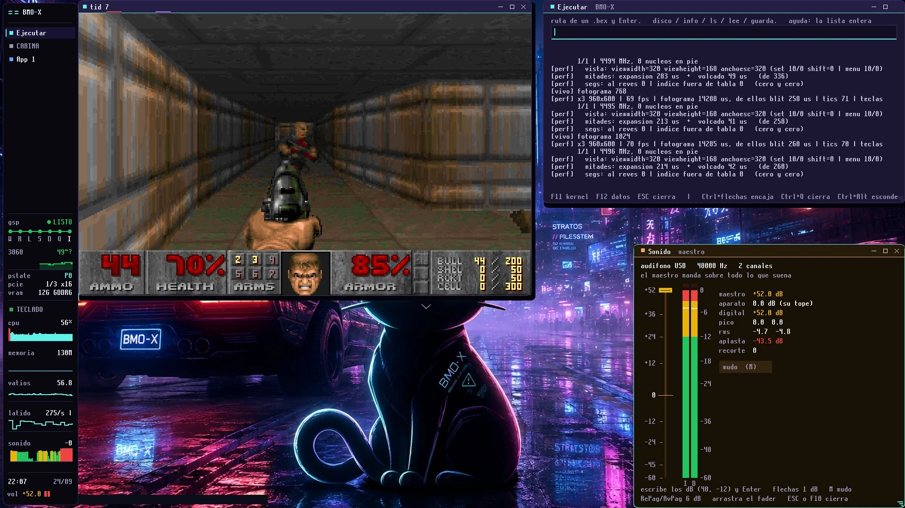

A capture of the desktop on the Ryzen: DOOM in a window at x3 960x600 and
~70 fps (its `[perf]` lines in the Ejecutar window say so), the MAESTRO sound
panel, and in the side panel the RTX 3060 **driven by BMO-X**: `gsp LISTO`,
49 degrees, `P0`, PCIe Gen3 x16, 12 GiB of GDDR6. The same boot passed
`save mode` 51 of 51.

## 14. The pointer's bubble -- a render, and said so

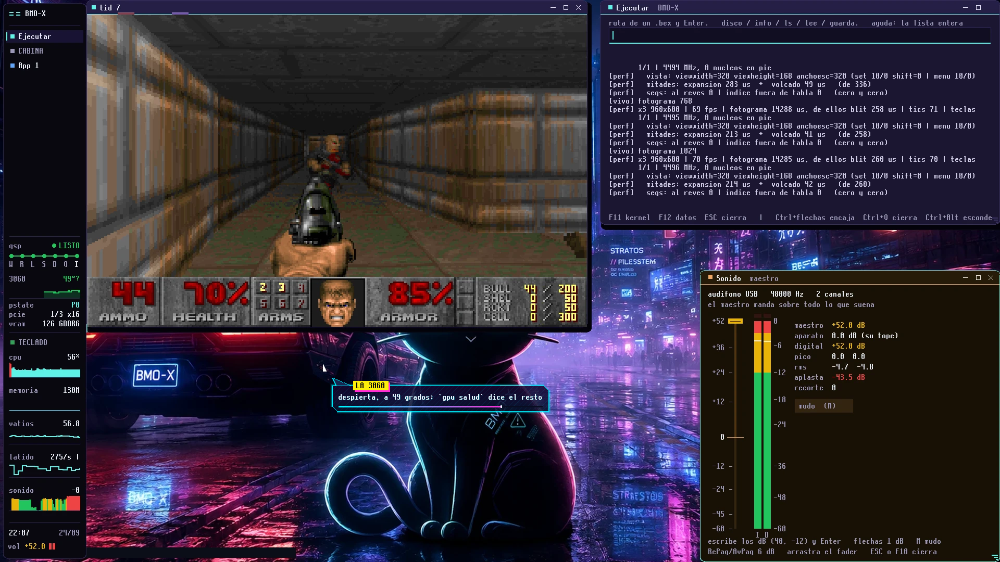

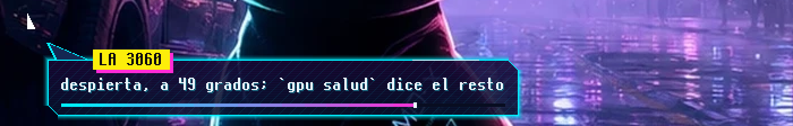

**These two are not photos of the monitor.** The bubble was drawn by the very
same `Ultra_userspace/services/director/src/scene/globo.rs`, compiled on the
host against a fake `Pantalla` that uses BMO-X's real 8x16 font
(`userland/src/font16_data.rs`), on top of capture 22. They show what the code
paints, 4 seconds into a bubble's life. A photo from the metal replaces them
when it exists -- and until then the caption says what they are.

## 15. The RTX 3060 thinks in floating point, and a path tracer runs in a window (2026-10-11)

Ten captures BMO-X took of itself on the Ryzen between 04:10 and 04:16, with
`Impr Pant` (1920x1080, written to `capturas/` through its own FAT32 driver
-- the log under each one says how long: the photo 1 ms, the PNG ~65 ms of
CPU, the disk 4-7 ms). Like section 12, these are **screen captures, and said
so**: the claim they back is what BMO-X drew, and the camera photos above
already back "this is not an emulator". The full log of the session is
[`../metal/METAL_2026-10-11.md`](../metal/METAL_2026-10-11.md).

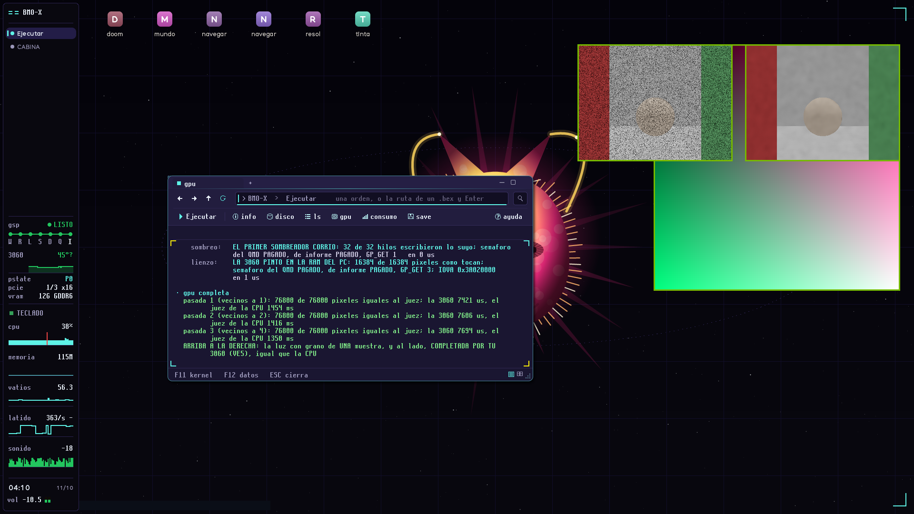

**`gpu completa` -- the card's first floating-point program, judged.** Top
right: the light of the house path tracer with ONE sample per pixel (grain),
and beside it the same light **completed by the RTX 3060** (VE5: three passes
of an edge-aware a-trous filter, guided by each pixel's normal, depth and
albedo, in SM86 floating point -- `FADD`, `FMUL`, `FMNMX`, `FSETP`,
`MUFU.RCP`). The box is the judge, pass by pass: `76800 de 76800 pixeles
iguales al juez`, the card 7421, 7606 and 7694 us, the CPU recomputing every
pixel in soft float 1454, 1416 and 1350 ms. Above it, the two oldest tests
still passing in the same boot (the first shader, 32 of 32; the canvas in the
PC's RAM, 16384 of 16384).

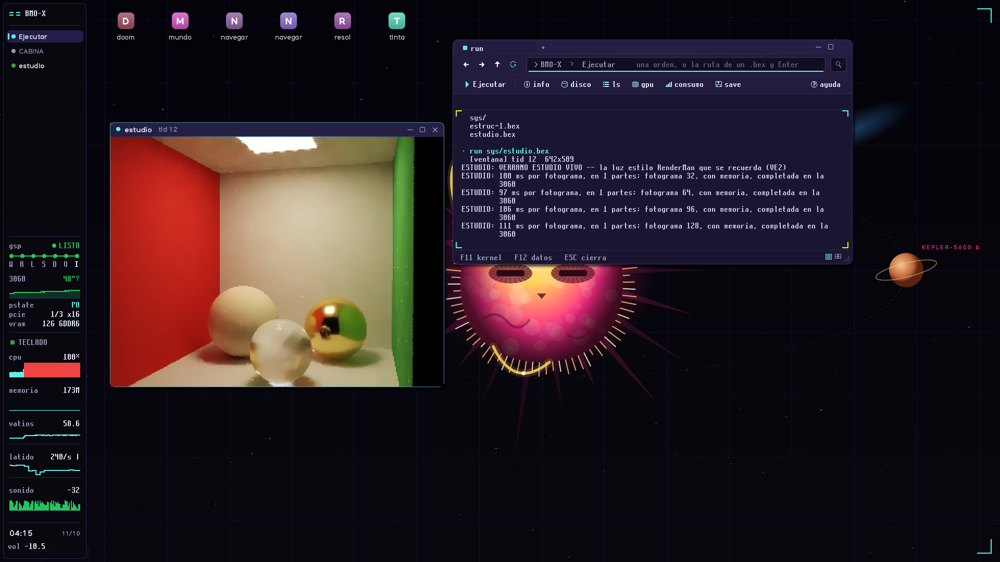

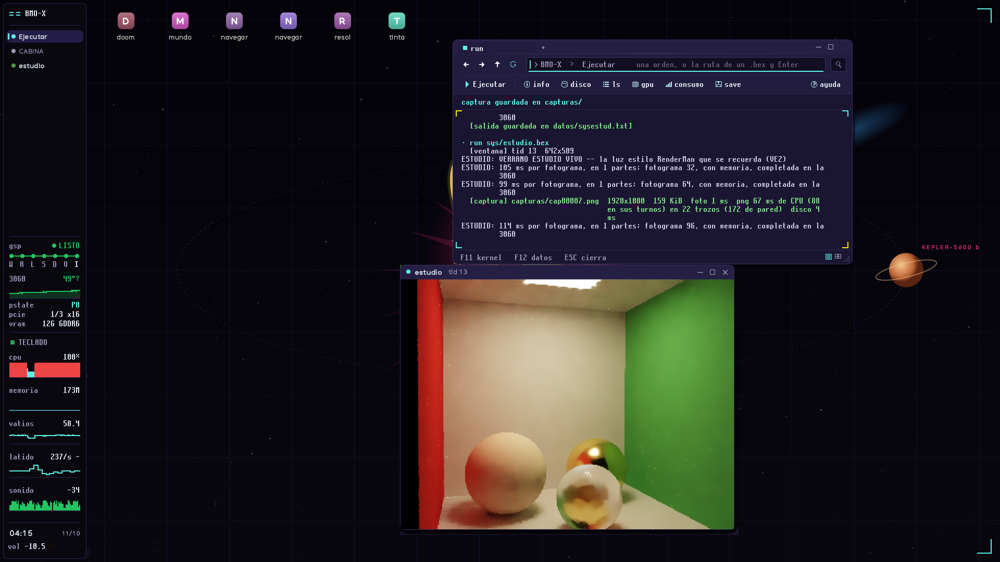
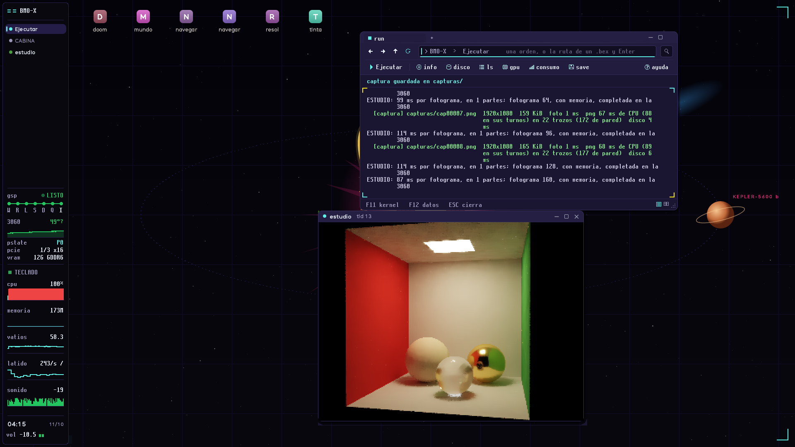
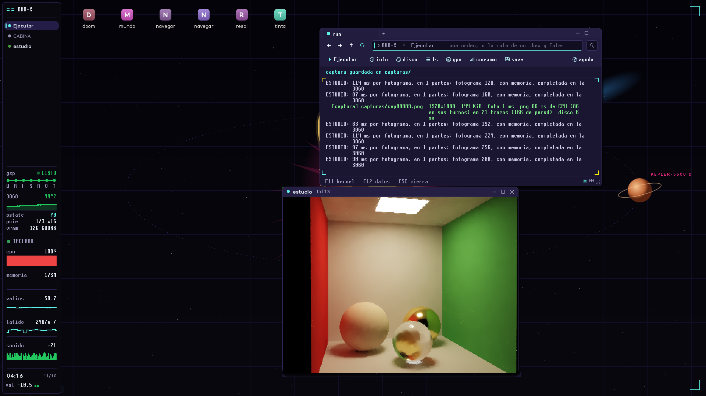

**`run sys/estudio.bex` -- ESTUDIO VIVO, the RenderMan-style path tracer, in
its own window.** A Cornell box: red and green walls, a diffuse sphere, a
gold one and a glass one, the lamp through the ceiling. Traced on **one**
core, for the first time with **hardware SSE in Ring 3** (until that day
every float a Ring 3 program did was soft float), and **completed by the
3060 every frame** through a narrow kernel door: 83 to 114 ms per frame, and
every line of the log says `completada en la 3060`. The window was moved and
resized between captures; the picture keeps converging (`con memoria`). The
side panel tells the rest: `cpu 100%` (one core flat out -- `smp all` is what
spreads it, and is what still resets the PC), the card at `P0` and 49
degrees, and `pcie 1/3 x16`: the link at **Gen1** out of the board's **Gen3**.
A 3060 trains at Gen1 from a cold boot and its own firmware raises it with
the performance level; under BMO-X it has run at Gen3 before (the
whole-screen copy measured ~12.8 GB/s on 2026-09-25), and `gpu relojes` now
says the link before and after asking for `PERF_BOOST`.

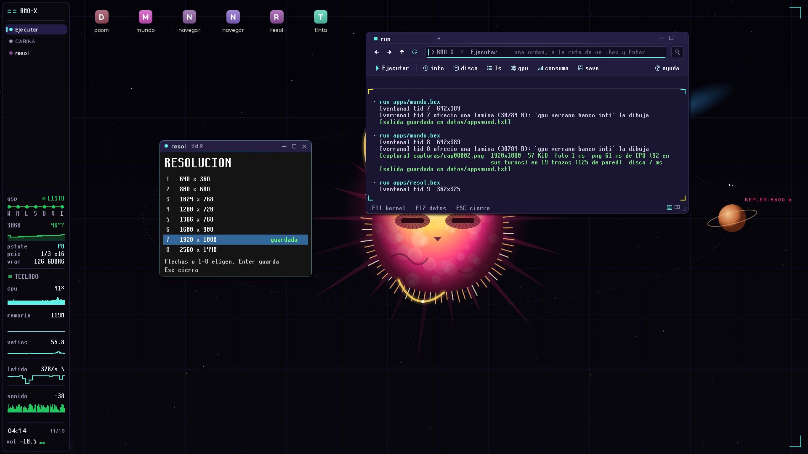

**`run apps/resol.bex` -- RESOLUCION**, a TITAN++ app: eight modes, arrows
or 1-8 to choose, Enter saves -- `1920 x 1080 guardada`, in
`datos/resol.txt`, which the other windows read. The first TITAN++ program
that writes a setting other programs obey.

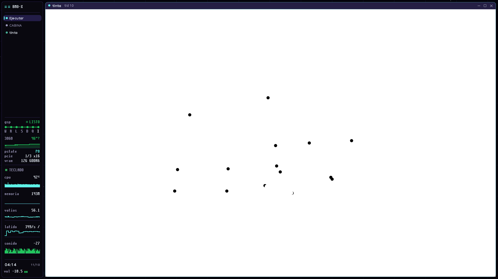

**TINTA** -- the minimal TITAN++ canvas (TB1), full window at 1738x1064: each
click a dot. Small, and the point: a TITAN++ program reading the mouse and
painting its own pixels.

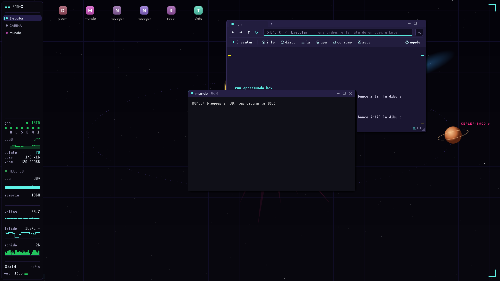
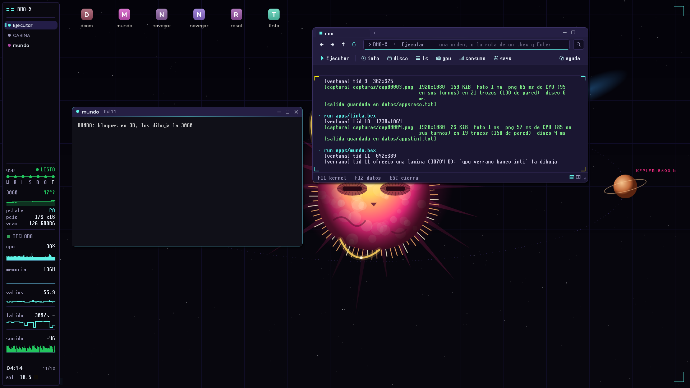

**MUNDO, and it did NOT draw -- kept here on purpose.** The 3D block world
opens its window and says `bloques en 3D, los dibuja la 3060`, and the log
says its sheet was offered (`ofrecio una lamina (30784 B)`), but the picture
never comes. MUNDO is the first sheet that asks the 3060 for **depth**, and
the card's depth buffer has not been seen on the metal yet (M1). Why it
stops now prints in the box, not only in the kernel panel; the next run says
it. A folder of only the successes would not be evidence.

## How this folder works

These are **progress markers, one batch per milestone**. When something starts
running on the Ryzen, it gets photographed and lands here with a name that says
what it shows. Nothing is added because it should work.

### Video: the rule, corrected

This section used to say **"deliberately no video in the repository"**. The rule
was sound and only half of it was: git never forgets a blob, so an *unbounded*
video is a permanent cost -- but a short clip is not. So it becomes a **ceiling**
instead of a ban:

> A clip **under 5 MB** may live here. Anything longer goes on the channel and
> gets linked from this file.

### `15.mp4` -- the boot, edited, with an intro

**2026-08-18. 7,3 s, 848x480, with sound.** An edited presentation piece: the
machine powering up, the firmware's own boot picker, and BMO-X coming up. It has
a title card, which is why it is *this* recording and not the evidence take
described below -- the two are different jobs and the table says which is which.

Committed on 2026-09-05 under the ceiling above, at 1,67 MB. `15-arranque.gif`
(2,1 MB, 480 px, 10 fps, no sound) is the same seven seconds as an animated GIF,
and it exists for one reason: **GitHub does not play a repository `.mp4` inside a
README.** A markdown link opens the file's own page; a GIF plays where it sits.
So the GIF is the one in the README and the MP4 is the one worth watching. Before that it sat
in this folder for two and a half weeks **uncommitted and cited by nobody**,
which is the state this caption exists to end: a recording without a caption is
evidence of nothing.

> [!] **What it is not.** Seven seconds with a title card is a *teaser*, and at
> 848x480 nobody can read a kernel log line off it. It is the right file for the
> top of the README and **the wrong one for the sceptic** -- who is the person
> the next section is written for, and whose take has not been shot yet.

### The two recordings are different jobs -- do not merge them

|  | THE EVIDENCE TAKE | THE PRESENTATION |
|---|---|---|
| for | the sceptic who thinks the stills are faked | somebody who has never heard of this |
| shape | one continuous take, **no cuts** | intro, title, narration, edits |
| content | power on -> BMO-X -> `batch.bex` -> hold ten seconds on the output | the boot, and what is happening while it happens |
| lives | here, or linked here | the README, at the top |

The rules below apply to **the evidence take only**. An intro on that one
destroys the very thing it exists to prove -- a cut is what people suspect. On
the presentation an intro is not a flaw; it is the point.

- Camera on the physical screen, never a screen capture
- One take, no cuts
- Phone quality is fine; **steadiness matters more than resolution**
- No intro, no music, no narration

### What the boot proves, and it is worth saying out loud

The firmware's own picker lists `BMO-X` next to `Windows Boot Manager` -- see
photo 1. **BMO-X is not booted through Ventoy, GRUB, or any other loader**: it
is a UEFI boot entry on its own partition, chosen by the motherboard.

That distinction is not decoration. A system launched from inside a multi-boot
loader can always be waved away as a payload. One the firmware itself boots
cannot.

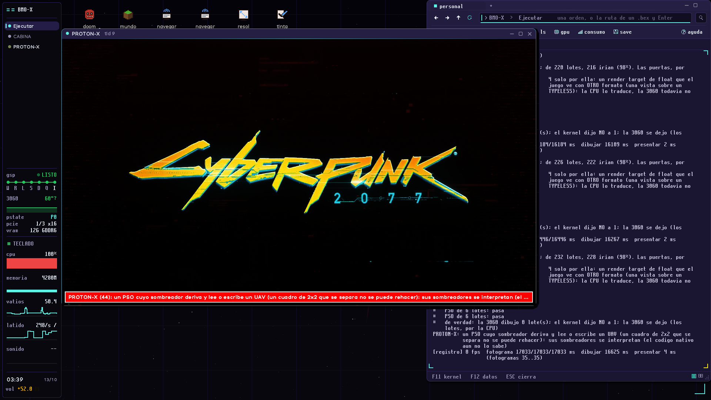
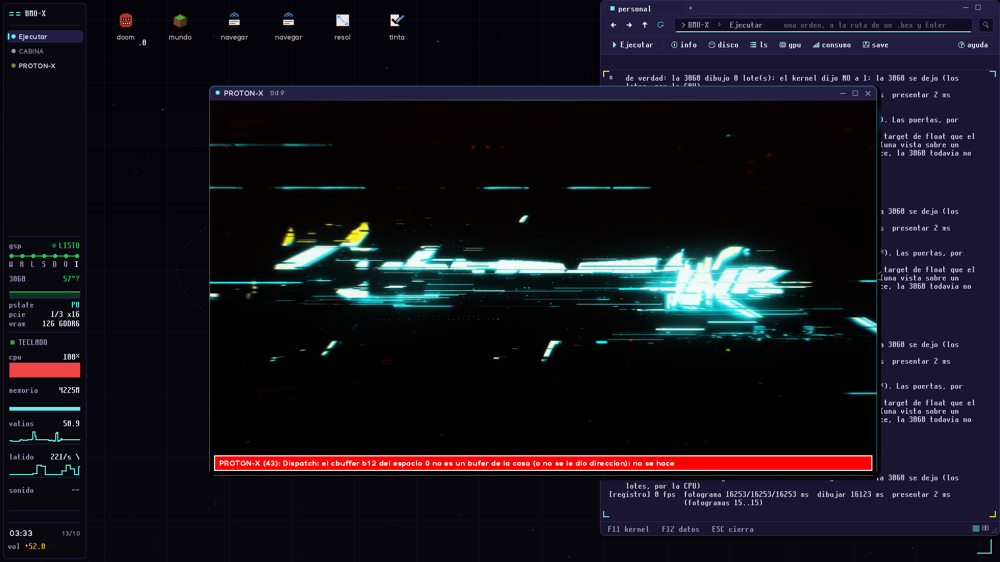
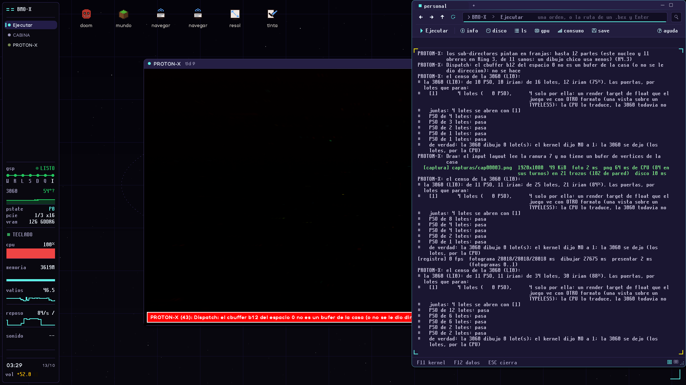

**`personal 3060 Cyberpunk2077.exe` -- the first AAA game on BMO-X (13-10).**
Captured by BMO-X itself (`capturas/cap00004..6.png`, renamed here). The
unmodified Windows game, read from the NTFS disk, draws its intro through
PROTON-X: its loader, its Windows functions, its Direct3D 12. **On the CPU**,
about 16 s per frame; 228 of 232 batches would pass every gate to the RTX
3060, but its graphics channel was already dead (a Xid) and it drew none.
Photo 36 is the same intro with the compute shaders PROTON-X cannot run yet
skipped -- that is what the glitches are. Photo 37 is the console: the
census, gate by gate, and `de verdad: la 3060 dibujo 0 lote(s)`. The run:
[`METAL_2026-10-13.md`](../metal/METAL_2026-10-13.md).
