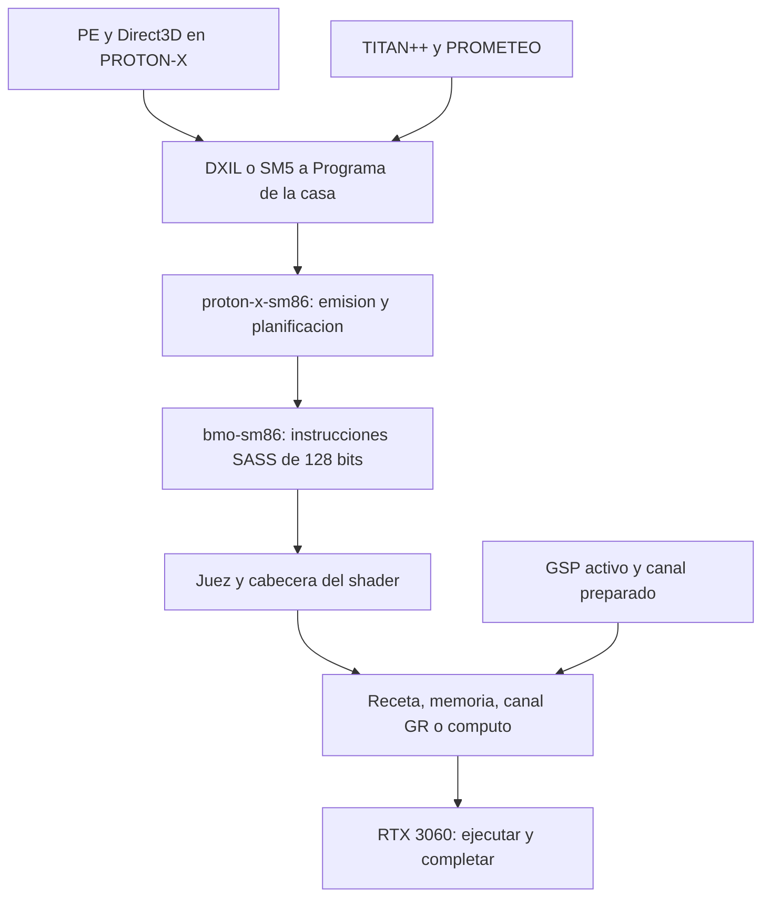

# RTX 3060 12G: arranque, PROTON-X y ensamblado SM86

Pregunta del propietario: que se puede resolver estudiando a fondo SU RTX
3060 12G, PROTON-X y sus bibliotecas de ensamblado. Auditoria del 16-10-2026,
sobre `6c075c0a4`. Lectura de codigo, informes ya conservados y fuentes
primarias; pruebas en anfitrion. Sin nueva ejecucion en la tarjeta.

## Resultado

Hay dos limites concretos y una hipotesis nueva para G0:

| Hallazgo | Evidencia | Consecuencia |
| --- | --- | --- |
| G0-MODO: preparacion inicial distinta de OpenRM 570.144 | BMO-X selecciona Falcon antes del booter; OpenRM selecciona RISC-V | Comparar el protocolo completo; causa del 0x15 aun sin demostrar. |
| Z en PROTON-X sigue limitada a 1280x720 | `puerta::medida` y sus pruebas | Un destino distinto puede ser rechazado antes del kernel, aunque la RTX este activa. |
| Las bibliotecas generan SASS nativo, con limites propios | Emisor, juez y recetas | Ampliar SASS ayuda a traducir shaders; no corrige por si solo un GSP que no arranco. |

G0 sigue abierto. Q0a3 (cuatro pixeles distintos) sigue abierto. No se
cierra ninguno con estas pruebas de anfitrion.

## 1. La tarjeta concreta y lo que significa tener 12G

El [perfil medido](ANATOMIA.md) identifica PCI `10DE:2504`, subsistema
`1462:397D`, GA106 A1, 12288 MiB GDDR6 y SM86. La investigacion previa en
Windows registro 28 SM, bus de memoria de 192 bits y enlace PCIe Gen3 x16
en esta placa. Esas mediciones son historicas; no son un benchmark nuevo
de BMO-X ni identifican por si solas el modelo comercial del disipador.

NVIDIA documenta para capacidad 8.6 hasta 48 warps por SM, 64K registros de
32 bits por SM y 255 registros por hilo; 100 KiB de memoria compartida por
SM y hasta 99 KiB por bloque con la configuracion adecuada. Estos recursos
limitan concurrencia independientemente de la VRAM total. No trasladar
funciones exclusivas de A100/SM80 a GA106/SM86.
[Fuente: guia Ampere](https://docs.nvidia.com/cuda/ampere-tuning-guide/index.html).

Los 12G no significan que cualquier shader, formato, API o destino ya este
soportado. Tampoco equivalen al espacio visible por BAR1: el perfil de esta
maquina registra BAR1 de 256 MiB. Asignacion de VRAM, traduccion de direcciones
y ventanas de acceso son contratos distintos. Ver
[como le habla NVIDIA](COMO_LE_HABLA_NVIDIA.md).

## 2. Que hace cada biblioteca

El dibujo resume dependencias funcionales; PROMETEO es la representacion
comun, no depende de PROTON-X ni de un driver NVIDIA.

| Pieza en el repositorio | Responsabilidad | Limite de la evidencia |
| --- | --- | --- |
| `platform/shared/prometeo` | Programa comun, interprete y contrato de tarjeta | Ejecutar el interprete no comprueba la GPU. |
| `platform/shared/proton-x` | Lectura y traduccion de programas Windows/shaders | Una instruccion traducida no acredita todo Direct3D. |
| `platform/shared/bmo-sm86` | Codificar SASS: aritmetica, memoria, atomicas, olas | No inicializa firmware, canal ni recursos de un juego. |
| `platform/shared/proton-x-sm86` | Asignar registros, emitir, planificar y adaptar el programa | Puede rechazar operacion, registros, forma o programa no SSA. |
| `toolchain/forge/tarjeta-rtx3060-12g` | Adaptador de PROMETEO para esta tarjeta | Usa un presupuesto distinto del camino PROTON-X. |
| `platform/drivers/gpu/ga10x/src/sass` | Decodificar y juzgar instrucciones y dependencias | Contrato parcial de instrucciones admitidas; no prueba universal de SM86. |
| `platform/drivers/gpu/ga10x/src/trabajos` | Destinos, texturas, cabeceras y ordenes de ejecucion | Requiere memoria, sincronizacion y contexto correctos. |
| `Ultra_kernel_x86-64/kernel/src/ring0/dev/gpu_despertar.rs` | Preparar GSP y lanzar booter | Ocurre antes del shader del juego. |

Aqui ASM significa SASS SM86, instrucciones de GPU de 16 bytes, no el
ensamblador x86-64 del procesador. El codificador entrega dos palabras
de 64 bits; el adaptador las serializa en orden little-endian.
NVIDIA publica familias de instrucciones Ampere y herramientas de
desensamblado. Esa referencia no especifica por completo todos los bits
ni demuestra los tiempos y dependencias del emisor local.
[Fuente: Binary Utilities](https://docs.nvidia.com/cuda/cuda-binary-utilities/index.html#instruction-set-reference).

## 3. G0-MODO: diferencia que merece una prueba controlada

En `despertar()`, BMO-X termina FWSEC, llama a `fa::resetear(GSP, boot0)`
y arranca el Falcon sin programa, dejando LIBOS en los buzones. El paso
`booter()` exige despues observar ese Falcon parado antes de lanzar SEC2.
`resetear` selecciona Falcon, espera el borrado de memoria y escribe `RM`.

OpenRM **570.144**, la misma version de GSP-RM usada aqui, hace en su
arranque normal: FWSEC-FRTS si corresponde, `kflcnResetIntoRiscv_HAL`,
argumentos LIBOS y Booter Load. La implementacion GA102 programa
`BCR_CTRL` con seleccion RISC-V, VALID y BRFETCH. Fuentes fijadas al tag:
[bootstrap TU102](https://raw.githubusercontent.com/NVIDIA/open-gpu-kernel-modules/570.144/src/nvidia/src/kernel/gpu/gsp/arch/turing/kernel_gsp_tu102.c),
[reset GA102](https://raw.githubusercontent.com/NVIDIA/open-gpu-kernel-modules/570.144/src/nvidia/src/kernel/gpu/falcon/arch/ampere/kernel_falcon_ga102.c).

La ruta de nova-core consultada en `master` tambien reinicia y arranca el
Falcon antes del booter; su seleccion de nucleo es Falcon. Por tanto,
hay dos protocolos publicos distintos y el local tiene un antecedente.
`master` es una referencia mutable consultada el 16-10-2026, sin SHA
fijado en esta auditoria. Fuentes:
[arranque TU102](https://raw.githubusercontent.com/torvalds/linux/master/drivers/gpu/nova-core/gsp/hal/tu102.rs),
[seleccion GA102](https://raw.githubusercontent.com/torvalds/linux/master/drivers/gpu/nova-core/falcon/hal/ga102.rs),
[reset y boot del Falcon](https://raw.githubusercontent.com/torvalds/linux/master/drivers/gpu/nova-core/falcon.rs).

**Hipotesis G0-MODO:** esa preparacion podria influir en la entrega al
booter 570.144. No demuestra que Falcon sea incorrecto: BMO-X ha tenido
arranques buenos con esa ruta. Tampoco se ha verificado un significado
publico preciso de `0x15` en las fuentes examinadas.

`resetear_en_riscv` ya existe localmente y programa `0x111`; se usa en
CORE_RESUME. Eso no cambia el arranque inicial descrito arriba. Sustituir
solo una llamada dejaria incompatibles el arranque vacio y la comprobacion
de Falcon parado. No se hizo ese cambio.

Prueba que haria esta hipotesis revisable:

1. Recoger primero `GSP ANTES` con los binarios nuevos: buzones, CPUCTL,
   BCR y puntero LIBOS esperado. Comparar con la autopsia posterior.
2. Revisar una variante completa del protocolo inicial RISC-V, incluidas
   las esperas y los estados exigidos por `booter()`. Conservar la ruta
   actual como referencia; mismo firmware, firmas y disposicion de memoria.
3. Probar una sola diferencia de protocolo, con identificacion de build y
   resultado por etapa: FWSEC, SEC2, entrega, GSP activo, INIT_DONE y dibujo.
4. Si vuelve 0x15 con la variante coherente, se debilita la hipotesis;
   si arranca una vez, sigue faltando demostrar fiabilidad. Comparar
   corridas equivalentes segun G0, aprovechando usos normales del equipo.

La foto previa del commit `f39e0658a` ya permite el paso 1 con cuatro
lecturas, sin cambiar la secuencia. Valores `BADF...` se conservan como
lecturas inaccesibles; no prueban por si solos que falte electricidad.
El [parte de metal](../../../../docs/metal/METAL_2026-10-16.md) conserva
el ultimo 0x15 en frio, firmware intacto y sin nuevos eventos IOMMU.
Esos negativos acotan el problema; no excluyen toda causa de memoria.

## 4. Limites actuales de PROTON-X que no son limites de la RTX

| Contrato local | Valor comprobado en codigo | Trabajo que habilitaria |
| --- | --- | --- |
| Programa admitido por el juez | Hasta 4096 instrucciones | Mejorar traduccion y dividir programas cuando corresponda; no afirmar ASM completo. |
| Adaptador nativo PROMETEO | Presupuesto base de 64 registros | Medir presion del programa antes de ampliar el contrato. |
| Emisor de la puerta PROTON-X | 238: 248 menos 2 reservados menos 8 del pegamento | Mantener reservas coherentes con cabecera y registros reales usados. |
| Texturas de la receta | 4 enlaces de textura/muestreador | Ampliar descriptores y sus pruebas; no basta cambiar la constante. |
| Destino PROTON-X con Z | `es_la_de_verrano()`: 1280x720 | Generalizar destino y superficie Z con paso, limites y copia coherentes. |
| Z tras dibujo CPU intercalado | La puerta invalida `z_viva` | Restaurar o limpiar profundidad antes de volver a GPU. |

Evidencia: `sass/juez.rs`, `trabajos/tuberia.rs`, `trabajos/texturas.rs`,
`trabajos/destino.rs` y `proton-x-sm86/src/puerta.rs`. Los enlaces de
textura/muestreador se cuentan como parejas: no necesariamente cuatro
imagenes diferentes.

La prueba `lo_que_la_puerta_no_dibuja_todavia` mantiene el rechazo de
256x256 con Z y la aceptacion de 1280x720. La correccion VRN1 para MUNDO
640x360 no elimina esta condicion de la puerta PROTON-X/VRN2. No retirar
el rechazo hasta hacer compatible la superficie de profundidad completa.

`--3060` solicita el backend y sus contadores; no garantiza que cada
dibujo se ejecute ahi. `--3060-solo` omite lo que no soporta: una imagen
incompleta no acredita exito. `--3060-escalera` agrega esperas de diagnostico;
no usarlo como benchmark. El censo cuenta lotes elegibles segun analisis;
para acreditar ejecucion hacen falta envio, finalizacion y resultado.

## 5. Que comprueba el ASM y que falta contrastar

El planificador usa latencias y barreras para resultados pendientes,
lecturas tardias de texturas, predicados y saltos. El juez vuelve a
comprobar instrucciones admitidas, registros, cabecera, dependencias y
drenado al salir o saltar. Conservar ambos controles.

Los simuladores de programa, grupo y cuadro verifican comportamiento
funcional; no modelan completamente ciclos, caches, concurrencia,
transporte PCIe ni cambios de contexto de la RTX. Compartir parte del
modelo con el emisor limita su independencia. Las comparaciones de
coma flotante tienen sus contratos propios, incluidas aproximaciones y
tratamiento de NaN; no equivalen a identidad universal bit por bit.

Hay referencias guardadas de PTXAS en las pruebas. En esta sesion no se
encontraron `ptxas` ni `nvdisasm` disponibles por PATH o en la ubicacion
CUDA habitual; no se genero un desensamblado NVIDIA independiente nuevo.
Para cada familia ampliada conviene conservar un vector independiente
con version de herramienta, bytes, desensamblado y resultado en tarjeta.

## 6. Orden de mejora y verificacion realizada

| Prioridad | Proximo trabajo | Criterio util |
| --- | --- | --- |
| 1 | G0: foto previa y auditoria del protocolo inicial | Localizar la primera divergencia sin atribuir 0x15 a una causa inventada. |
| 2 | Q0a3 cuando haya GSP y canal sanos | Aislar los cuatro pixeles con la misma escena y backend confirmado. |
| 3 | PROTON-X: destinos con Z y diagnostico por lote | Explicar cada rechazo y ampliar un contrato con pruebas negativas. |
| 4 | Cobertura de shaders de la carga elegida | Traducir el primer rechazo demostrado, con semantica y bytes contrastados. |
| 5 | Rendimiento | Medir primero; reducir registros, envios o copias sin perder igualdad. |

Pruebas ejecutadas en este estudio:

- `cargo test -q -p bmo-sm86 -p bmo-proton-x-sm86 -p bmo-gpu-ga10x -p bmo-prometeo`:
  592 aprobadas, cero fallidas y una ignorada por declaracion previa.
- `cargo test -q -p bmo-tarjeta-rtx3060-12g`: cuatro aprobadas.
- La ignorada es `todos_los_f32` de PROMETEO, un barrido exhaustivo
  documentado para ejecutarse aparte en release. No se ejecuto aqui.

Total: **596 pruebas aprobadas**, una ignorada. No se modificaron driver,
firmware, registros, voltajes ni secuencia de reset; no hay build nuevo
que desplegar por este documento. La comprobacion pendiente en metal es
la foto previa ya implementada, no una supuesta reparacion de esta auditoria.
